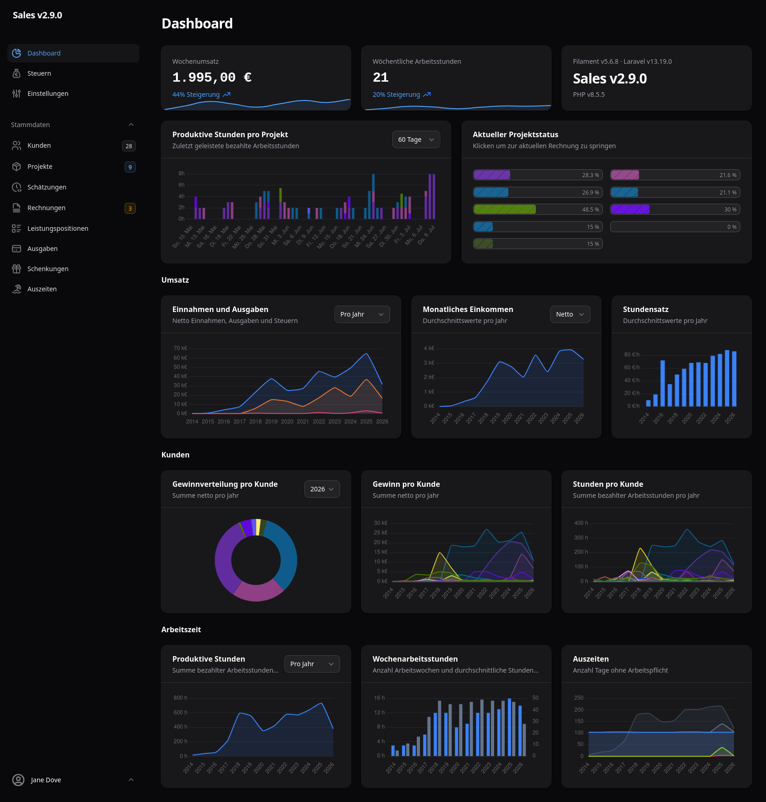

# Sales

A service sales manager especially for freelancers. Built in German, available in English too.

## Features

- A dashboard showing current trends and tax data, including a yearly overview of daily earnings, expenses, taxes and times off
- Keep track of clients
- Create projects for clients and provide estimations
- Create invoices and fill them with descriptive positions
- Export quotes or invoices from projects as PDF
- Send invoice positions to a client's own time tracking or finance system via API
- Keep track of expenses and taxes
- Keep track of gifts and donations (e.g. if you're an OS maintainer)
- Anonymize data in staging/dev environments



## Getting Started

There are two ways to get Sales up and running.

### 1. Install using DDEV with Docker (recommended)

```bash
git clone https://github.com/devmount/sales # get files
cd sales                  # switch to app directory
cp .env.example .env      # init environment configuration
ddev start                # Create docker containers and start them
ddev artisan migrate      # create database structure
ddev artisan key:generate # build a secure key for the app
ddev artisan db:seed      # create initial admin user
```

You can now login at <https://sales.ddev.site/>.

### 2. Install directly

Prerequisites:

- PHP 8.5+
- PHP extensions: mbstring, zip, xml, curl, dom, intl, mysql
- Composer 2.5+

```bash
git clone https://github.com/devmount/sales # get files
cd sales                       # switch to app directory
composer install               # install dependencies
cp .env.example .env           # init environment configuration
touch database/database.sqlite # create database file (or setup your database of choice)
php artisan migrate            # create database structure
php artisan key:generate       # build a secure key for the app
php artisan db:seed            # create initial admin user
pnpm install
```

## Commands

To anonymize all personal data, run the following command:

```bash
ddev artisan db:anonymize
```

## External API

Some clients require worked positions to be registered in their own systems. For those clients, you can configure an API in the _API_ section of the client form. The invoice action _Register positions_ then sends each position of an invoice as a separate HTTP request. The id returned by the API is stored on the position, so a position is never sent twice.

The configuration consists of:

- **URL** and **method** (`POST` by default) of the endpoint creating a single entry
- **Authentication**: none, a static bearer token, basic auth, or a login (username and password are posted as JSON to a login URL, the token is read from the configured response field, `token` by default, and sent as bearer token)
- **Request body**: a JSON template for one position
- **Id field**: the response field holding the id of the created entry (`id` by default, dot notation like `data.id` is possible)

These placeholders can be used in the request body. They are inserted as JSON values, so don't wrap them in quotes:

| Placeholder | Value |
| --- | --- |
| `{date}` | Start date of the position (`Y-m-d`) |
| `{started_at}` | Start of the position (ISO 8601) |
| `{finished_at}` | End of the position (ISO 8601) |
| `{hours}` | Duration in hours without pause |
| `{pause}` | Pause duration in hours |
| `{description}` | Description of the position |
| `{remote}` | Whether the position was done remotely |
| `{invoice_title}` | Title of the invoice |
| `{project_reference}` | The _API reference_ set on the project, e.g. a project id in the client's system |

Example body:

```json
{"date": {date}, "hours": {hours}, "comment": {description}, "projectId": {project_reference}}
```

The API configuration including credentials is stored encrypted with the `APP_KEY`, so changing that key makes existing configurations unreadable.

## Development

To start a local development server, make sure to have _Docker_ and _ddev_ installed. Navigate to the project root directory and just run:

```bash
ddev start
```

You can now find the app at <https://sales.ddev.site/> with the initial admin user credentials (email: `admin@example.com`, password: `Joh.3,16`).

If you have issues with missing method or property definitions, the ide-helper definitions might need an upate:

```bash
ddev artisan ide-helper:generate 
```

## Testing

For a simple test suite run, execute:

```bash
ddev artisan test
```

If you want to check coverage, run:

```bash
ddev artisan test --coverage --min=0
```

## Production

To build the application for production without DDEV, run:

```bash
composer install --optimize-autoloader --no-dev
php artisan config:cache # combine all configuration files into a single, cached file
php artisan route:cache  # reduce all route registrations into a single method call within a cached file
php artisan view:cache   # precompile all blade views
php artisan filament:optimize # cache Filament components and precompile all icons
pnpm build
```

Don't run `filament:optimize` in development, since new resources, pages or widgets won't be discovered until the cache is cleared again with `php artisan filament:optimize-clear`.

In `.env` set `APP_DEBUG` to false and `APP_URL` to your production url. Change more values if needed.

The webserver should be configured to serve the `public/` directory as root.

If you don't have composer installed on your webserver (e.g. because you are restricted by your provider), you can download a portable version into the project root:

```bash
wget https://getcomposer.org/download/latest-stable/composer.phar
chmod +x composer.phar
php composer.phar # use composer commands like this
```

## License

This project is a filament / Laravel framework based open-sourced software licensed under the [MIT license](https://opensource.org/licenses/MIT).
